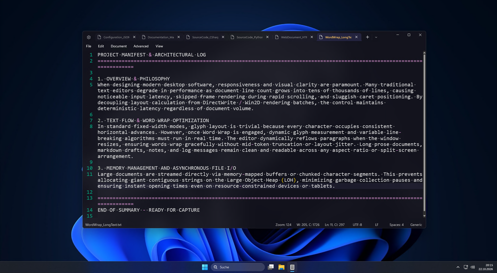
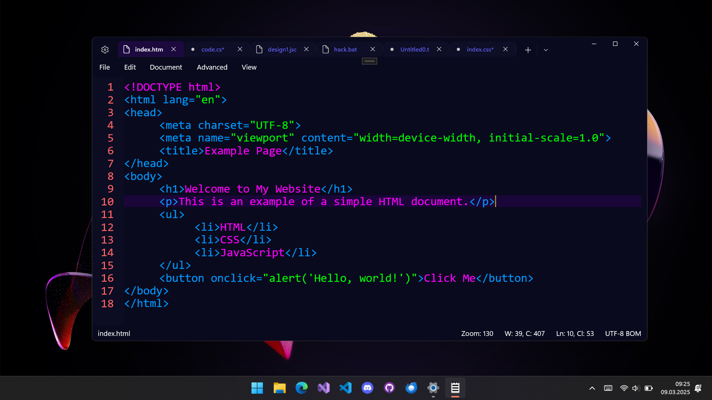
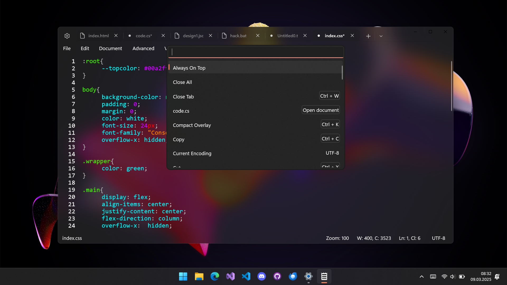
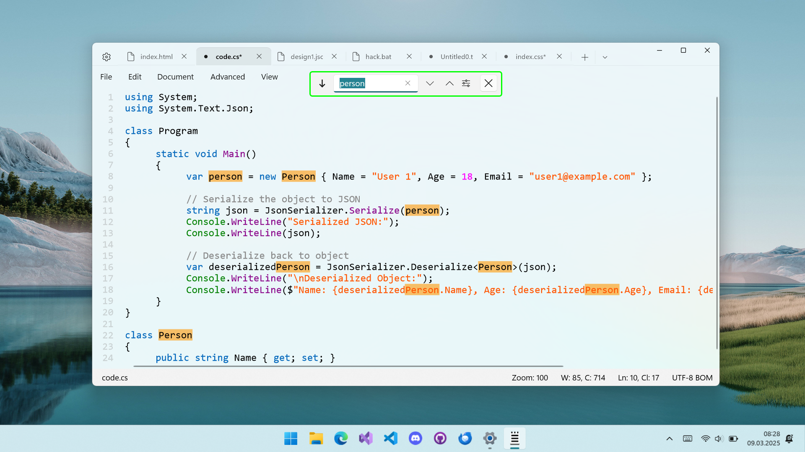

 

    
 

 <h1  align="center">Fastedit</h1>

    
    
    
    

## 🤔 What is Fastedit?
Fastedit is a fast, tabbed text editor for Windows 11, designed to bridge the gap between simple notepads and heavy IDEs. It opens instantly, stays responsive even with massive files, and focuses on what actually matters when reading or editing text.

With the latest update, Fastedit now includes full word wrap support (one of the most requested features) allowing long lines in text and code files to wrap cleanly to your window without slowing down the editor.

Key Features:
- Smart Highlighting: Native syntax colors for common languages and data formats (Python, C#, C++, JavaScript, Markdown, JSON, XML, G-Code, and more). It even colors CSV columns for easier reading and includes a generic highlighter that automatically picks up dates, URLs, numbers, and strings in plain text or log files.
- Modern Reading & Navigation: Smooth scrolling, pinch-to-zoom, full precision touchpad gestures, and word wrap for documents of any size.
- Tabbed Workspace: Keep multiple documents organized in tabs, search and replace with ease, and don't worry about closing the app; automatic session snapshots keep your open files right where you left them.
- Touch & Pen Support: Natural tap-to-select gestures and fluid navigation on touch devices.

## Support my work  

## 📥 Download

## 🔍 Features:
- Word Wrap – Keep long text easily readable
- Tabbed Editing – Work with multiple documents at once.
- Customizable Designs – Personalize the editor's appearance.
- Syntax Highlighting – Supports various programming languages.
- Line Numbering – Easily track your code or text.
- Simple Auto Indentation – Maintain clean and structured code.
- Line Highlighter – Quickly locate the active line.
- Powerful Search – Multi-highlight and fast search capabilities.
- Undock Tabs – Edit multiple documents in separate windows.
- Session Snapshot – Restore your previous editing session.
- Recycle Bin – Recover accidentally deleted files.
- Quick Access – All commands in one place for efficiency.
- File Info Dialog – Get detailed insights about opened files.
- Encoding Support – Work with different text encodings.
- Vertical Tab Flyout – Easily navigate between open documents.
- Highly Customizable – Customize to your needs.

## 🚀 Building the project:
To build Fastedit you need Visual Studio and WinUI-3 installed. Then you can clone the repository and open the .sln file with Visual Studio.

## 👨‍👩‍👧‍👦 Contributors:
If you want to contribute to this project, feel free to open an <a href="https://github.com/FrozenAssassine/TextControlBox-UWP/issues/new">issue</a> or a <a href="https://github.com/FrozenAssassine/TextControlBox-UWP/pulls">pull request</a>.

## 📸 Images

    
    
    
    

